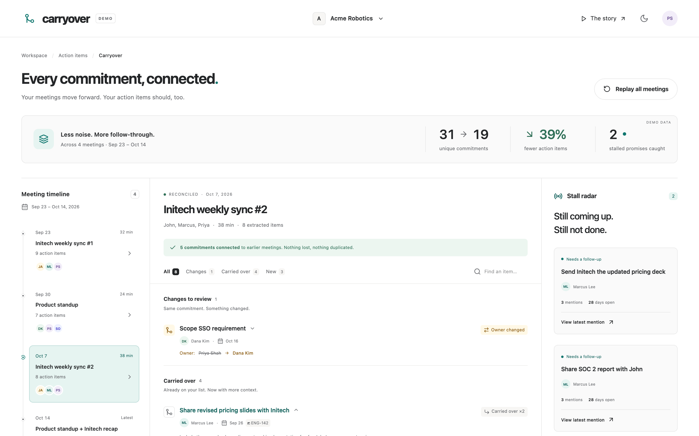
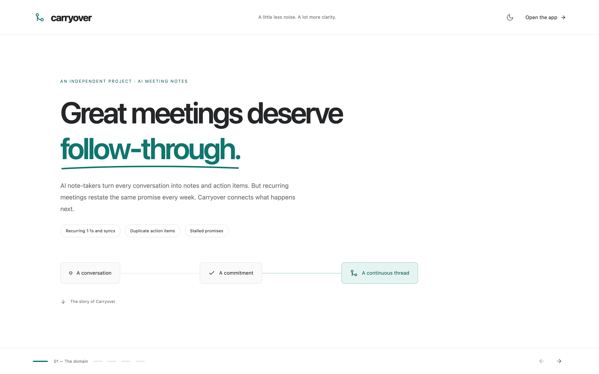
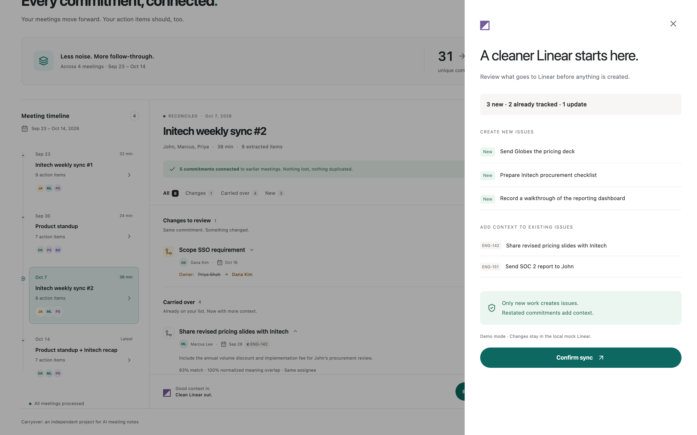
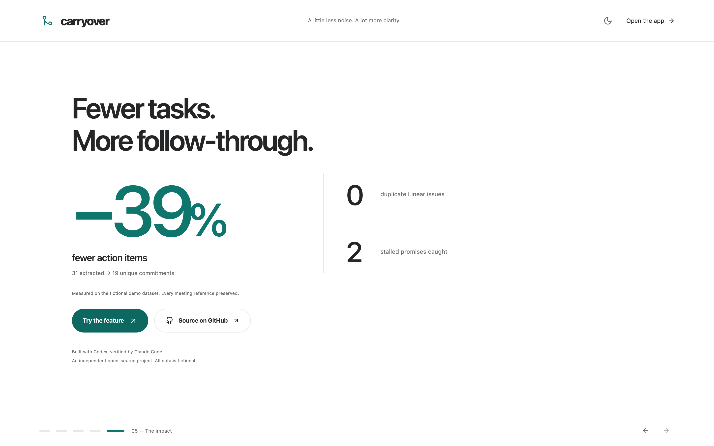

# Carryover

Cross-meeting action-item deduplication and a stall radar for AI meeting notes.

AI note-takers turn every meeting into notes and assigned action items, then push those items into trackers like Linear. Recurring meetings (weekly 1:1s, standups, customer syncs) restate the same promise again and again, and each restatement becomes a fresh task, or a fresh Linear issue. Carryover connects commitments across meetings so one promise stays one item, with every meeting it came from attached.

**Built with Codex, verified by Claude Code.** An independent open-source project. All people, workspace data, commitments, and Linear records in this demo are fictional. No external service or credential is required.

## Try it

Requires Node.js 22+ and pnpm 10 (the version is pinned in `package.json`).

```sh
pnpm install
pnpm db:seed
pnpm dev
```

If your host reports file-watcher `EMFILE` warnings, run `WATCHPACK_POLLING=true pnpm dev` to use polling.

Open [the workbench](http://localhost:3000), [the story](http://localhost:3000/story), or [the 20-second autoplay presentation](http://localhost:3000/story?autoplay=1).

SQLite defaults to `prisma/dev.db`; `.env` is optional. `.env.example` documents the setting. `pnpm db:seed` resets only the demo database, including mock Linear writes. Do not use it against a database containing real work.

On the workbench, the October 7 meeting starts selected. Expand a commitment for its matching score and meeting provenance, filter by verdict, or search titles. Review Linear sync shows **3 new · 2 already tracked · 1 update**. Confirm writes to the local mock; retrying is safe. Replay all meetings visibly collapses **31 extracted items into 19 unique commitments (39% fewer)**.






## The problem and why this feature

- **The problem.** Teams make commitments out loud, and AI note-takers capture them well inside one meeting. Across meetings they do not. "Send the pricing deck" said in four weekly syncs becomes four action items and, through an automation, four Linear issues. The list people trust to keep their promises fills with noise, and the genuinely stuck item is hidden among copies.
- **Evidence.** Users of popular AI note-takers have publicly asked for a way to match manual and AI-generated action items "to minimize duplicates", saying AI items were "clogging up my legitimate action items" and that of "15-20 AI generated action items only 1-2 were needed". Best-practice guides for meeting follow-up still tell people to manually reference incomplete items from previous sessions. Many meeting-notes APIs already model one action item as belonging to several meetings (`meetingIds[]`), so the data shape for continuity exists; the reconciliation step is what is missing.
- **Why this feature.** The alternative considered was inline citations from note bullets to transcript timestamps. Tools in this space already ship answer sources and transcript search, so that would mostly repeat existing work. Carryover protects the most-used surface instead (the action-item list and its tracker sync), and its core is a deterministic, testable matcher.

## What it does

- **New:** a distinct commitment, eligible to create a Linear issue.
- **Carried over:** a restated commitment; preserve its original identity and append meeting provenance.
- **Updated:** a matching commitment whose owner changed or deadline shifted at least one day. Show every change explicitly.
- **Ignored done:** a completed item or match to already completed work; no new issue.
- **Stall radar:** pending for at least 14 days and mentioned in at least three distinct meetings.
- **Linear gate:** create only new work; add comments to already tracked carryovers/updates. Both writes are idempotent and the whole confirmation is transactional.

The clock is injectable and defaults to **October 21, 2026**. The four meetings span two recurring series, with a combined product/customer recap. Their raw counts are 9 + 7 + 8 + 7 = 31. Five items repeat in meeting three; all seven repeat in meeting four, producing 19 unique items, exactly two owner/deadline conflicts, and exactly two stalls. Two existing issues, ENG-142 and ENG-151, are seeded.

## Measured impact (demo dataset)

| Metric | Without Carryover | With Carryover |
| --- | --- | --- |
| Action items across 4 meetings | 31 | 19 unique (-39%) |
| Linear issues created for the Oct 7 meeting (8 extracted items) | 8 (one per item) | 3 new; 2 tracked items get a comment instead |
| Restated items from that meeting treated as new | 5 | 0 (merged into existing items) |
| Duplicate Linear issues from that meeting | 2 | 0 |
| Owner/deadline changes surfaced | 0 | 2 |
| Stalled promises surfaced (14+ days, 3+ meetings) | 0 | 2 |

## How matching works

The pure engine in `src/lib/carryover` has no database or network dependencies.

1. Limit candidates to items from meetings sharing an attendee, series, or company.
2. Normalize title and description: lowercase, punctuation/filler/stopword removal, simple stemming, and phrase normalization.
3. Reject pairs that explicitly name disjoint known company entities (for example, Initech versus Globex).
4. Score `0.25 × lexical Jaccard + 0.65 × synonym-normalized Jaccard + 0.10 × same-assignee bonus`. The semantic map covers send/share, deck/slides, follow up/check in, and PR/pull request. Match at **0.62** or above.
5. Classify, compare owners/deadlines, and merge provenance. Reapplying the same meeting never increments its mention count twice.

This is a transparent lexical/semantic heuristic, not an embedding model or a live LLM. Known company names are supplied in context; production matching should expand entity recognition and calibrate against real labeled examples.

## Stack and architecture

**Next.js 15 Pages Router**, strict **TypeScript**, **React**, **SWR**, **Prisma 6** with **SQLite**, **Tailwind CSS v4**, **Instrument Sans via next/font/google**, **motion/react**, **Vitest**, and **React Testing Library**. SQLite stands in for PostgreSQL for a zero-setup local demo. Lucide supplies the icons.

- `prisma/schema.prisma`: companies, people, recurring series, meetings/attendees, action items/mentions, Linear issues/comments.
- `prisma/seed.ts`: reproducible fictional workspace and initial Linear records.
- `src/lib/carryover`: normalization, score, reconciliation, merge, stalls, sync planning, chronological replay.
- `src/services/source.ts`: `MeetingSource` interface; the default `SeedMeetingSource` reads Prisma. `HttpMeetingSource` is deliberately disabled and documents the seam for a real meeting-notes API (`MEETINGS_API_URL`).
- `src/services/extractor.ts`: `ActionItemExtractor` interface; seed extraction is deterministic. Replace it with an LLM adapter that validates extracted items.
- `src/services/linear.ts`: `LinearClient` implementation that persists mock issues/comments and records calls. Replace with a real server-only adapter if implementing a production integration.
- `src/services/workspace.ts`: reconstructs the historical item state before each meeting, so future mentions cannot affect earlier classifications.

Routes:

| Route | Behavior |
| --- | --- |
| `/` | Meeting timeline, grouped commitments, provenance, search/filter, replay, stall radar, sync review |
| `/story` | Five scroll-snapped animated scenes; `?autoplay=1` advances every four seconds, ending on impact |
| `GET /api/meetings` | Workspace, meetings, replay, metrics, stalls |
| `GET /api/meetings/:id/reconcile` | Meeting’s historical verdicts |
| `GET /api/stalls` | Radar at the injected clock |
| `GET /api/meetings/:id/linear-plan` | Create/comment plan and conflict count |
| `POST /api/meetings/:id/linear-plan` | Recompute and confirm the plan using the mock client |

The story has pause/previous/next controls, entrance and in-view animations, a shared-layout before/after diagram, and an animated impact counter. Reduced-motion users get final states and manual scene navigation. The raw counter uses the actual cumulative seed totals **9 → 16 → 24 → 31** (the plan’s illustrative 9 → 17 → 25 → 31 does not match its specified seed counts). Attribution says **Built with Codex, verified by Claude Code**. The source is published at https://github.com/Dileep2896/meeting-carryover.

## Validation

```sh
pnpm test       # core, seed metrics, React component, transactional mock integration
pnpm typecheck
pnpm lint
pnpm build
pnpm start
```

Run `pnpm db:seed` before the suite on a fresh checkout; the mock integration test uses the seeded database and rolls back its own writes. Core tests were written and run before the implementation. The metric test asserts exact seed totals, two updates, two stalls, and two existing issues.

See [the validation record](docs/VALIDATION.md) for the completed checks.

Browser checks (optional, after building):

```sh
PLAYWRIGHT_BROWSERS_PATH=.cache/playwright pnpm exec playwright install chromium
PLAYWRIGHT_BROWSERS_PATH=.cache/playwright pnpm test:e2e
```

The browser suite verifies meeting selection, provenance, filters, replay, mock sync, dark mode, responsive widths, story autoplay, and reduced motion. Screenshots are written under `.cache/qa/`. Browser sync checks write mock records; `pnpm db:seed` restores the original fixture afterward.

## PostgreSQL and hosting

The app uses standard Next.js API routes and is Vercel-compatible without a custom server. Local SQLite is for the demo; a writable persistent SQLite file is **not** suitable for Vercel’s ephemeral serverless filesystem.

For a hosted deployment:

1. Change the datasource provider in `prisma/schema.prisma` from `sqlite` to `postgresql` (one line).
2. Set `DATABASE_URL` to a server-only PostgreSQL connection string in your deployment environment. Export it in your shell when running Prisma CLI commands.
3. Run `pnpm exec prisma generate`, create/review your migration, and run `prisma migrate deploy` against the hosted database. For an empty demo database, `pnpm db:seed` pushes the schema and seeds it.
4. Build with `pnpm build`; configure the database URL in Vercel. Do not expose credentials through `NEXT_PUBLIC_*`.

No real API key is used, generated, or committed. `.gitignore` excludes `.cache/`, `node_modules/`, `.venv/`, environment files, build output, and SQLite files.

## Scope

Implemented: the feature, mock persistence, deterministic replay, and animated story. Real meeting-API/LLM/Linear integrations, authentication, and production deployment are outside this local prototype.
